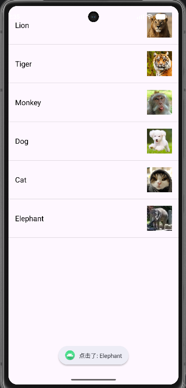
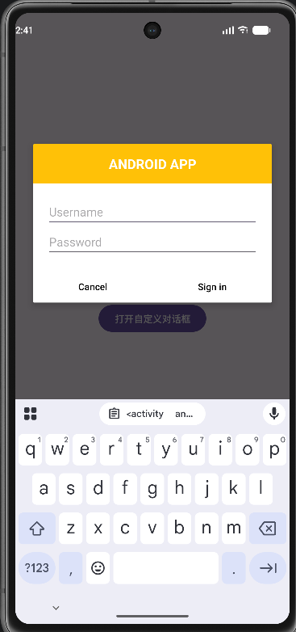
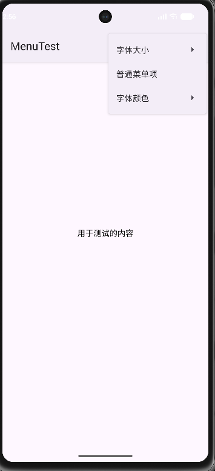
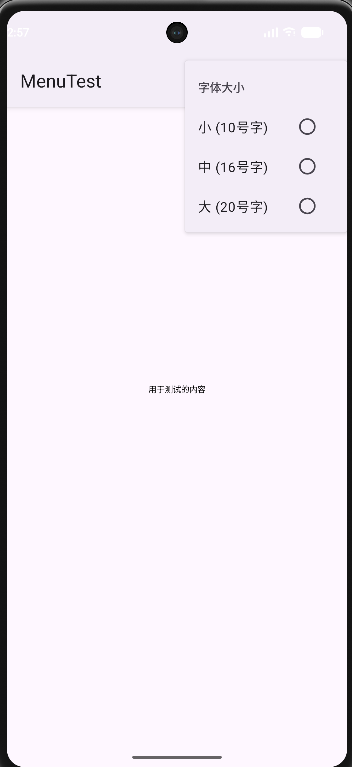
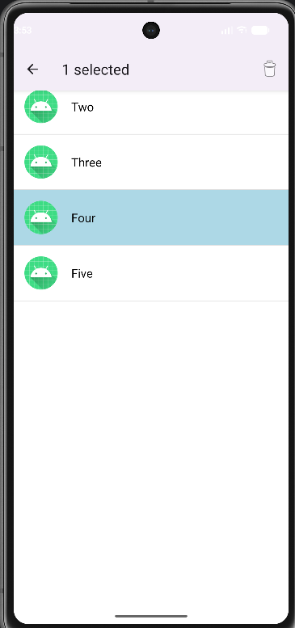
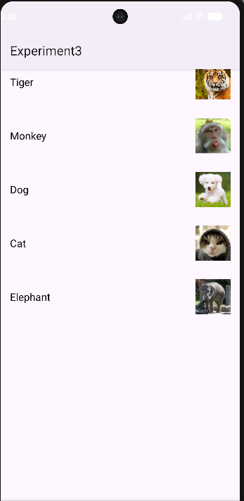

# Android 界面组件实验（实验三）

## 👨‍🎓 学生信息
- **姓名**：洪凯翔
- **学号**：121052024058
- **班级**：软工2班

## 📖 项目简介
本项目为 Android 界面组件实验，涵盖了 `ListView`、`AlertDialog`、`XML菜单`、`ActionMode上下文菜单` 以及 `RecyclerView` 等核心组件的使用。通过五个独立的任务，掌握了 Android 传统 View 体系下复杂界面的构建与交互逻辑。

---

## 🚀 任务展示

### 任务1：ListView 与 SimpleAdapter
**效果展示：**

*(请将图片命名为 task1.png 并放入 images 文件夹)*

**实现要点**：
使用 `SimpleAdapter` 将图片和文字数据绑定到 `ListView`。单击列表项弹出了 `Toast` 提示，并实现了发送系统通知（Notification）的功能。

### 任务2：创建自定义布局的 AlertDialog
**效果展示：**

**实现要点**：
创建了 `dialog_sign_in.xml` 自定义布局（包含橙色标题栏、用户名、密码输入框和按钮），并通过 `AlertDialog.Builder().setView()` 将其加载到对话框中，实现了 Cancel 关闭和 Sign in 的交互。

### 任务3：使用 XML 定义菜单
**效果展示（主菜单）：**

*(请将截图命名为 task3_1.png)*

**效果展示（子菜单与字体效果）：**

*(请将截图命名为 task3_2.png，例如展示点击“字体大小”后的子菜单，或字体变红/变大后的效果)*

**实现要点**：
在 `res/menu` 下使用 XML 定义了包含单选组（`single`）的菜单。实现了“字体大小”（小/中/大）和“字体颜色”（红/黑）的动态切换，以及“普通菜单项”的 Toast 提示。

### 任务4：创建上下文操作模式(ActionMode)的上下文菜单
**效果展示：**

**实现要点**：
使用 `ListView` 开启 `CHOICE_MODE_MULTIPLE_MODAL` 多选模式。长按列表项时触发 `ActionMode`，顶部显示“X selected”和垃圾桶图标，选中项背景变蓝。点击垃圾桶成功删除了选中项。

### 任务5：使用 RecyclerView 实现列表视图效果
**效果展示：**

**实现要点**：
使用 `RecyclerView`、`Adapter` 与 `ViewHolder` 展示动物图片和名称。自定义了 `item_recycler.xml` 布局，实现了点击列表项显示名称 Toast，以及滚动时的性能优化。

---

## 💡 遇到的问题与解决方案

本次实验不仅考察了 UI 组件的使用，还在环境配置和调试中踩了很多坑：

1. **Gradle 依赖下载失败**
    - **问题**：引入 `RecyclerView` 时，Android Studio 无法从 Google 服务器下载依赖，报错 `UnknownHostException`。
    - **解决**：将 `settings.gradle.kts` 中的仓库源替换为阿里云镜像，完美解决了下载慢和失败的问题。

2. **模拟器 API 37 渲染异常（黑屏/第一项消失）**
    - **问题**：在 API 37 (Android 17) 模拟器上，实验一到实验四频繁出现界面全黑、`ActionMode` 列表第一项“One”不显示等诡异现象。通过查看 Logcat 发现是模拟器底层的 NFC/UWB 驱动持续崩溃导致渲染层异常。
    - **解决**：果断放弃 API 37 模拟器，新建了一个 **API 34** 的稳定版模拟器。所有黑屏和列表第一项消失的问题瞬间解决，这证明了代码本身无误，是预览版模拟器的兼容性Bug。

3. **ActionMode 选中背景色与文字冲突**
    - **问题**：长按选中列表项时，系统默认的 `activatedBackgroundIndicator` 背景色在深色模式下导致黑色文字隐形。
    - **解决**：在 `res/drawable` 下自定义了 `item_bg_selector.xml` 选择器，强制设置浅蓝色选中背景和黑色文字，彻底解决了视觉冲突。

---

## 🎓 实验心得
通过本次实验，我不仅掌握了 Android 四大组件的 UI 部分，更深刻理解了 `Adapter` 在数据和界面之间的桥梁作用。在排查模拟器渲染 Bug 和网络问题的过程中，我学会了如何通过 Logcat 定位问题，以及如何通过修改主题、布局和仓库配置来绕过环境障碍。这些经验为后续的 Android 开发打下了极其扎实的基础。